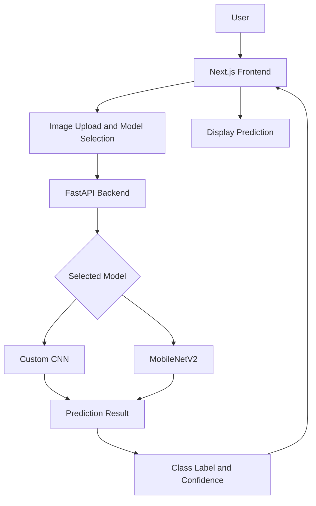

# Pakistan Sign Language (PSL) Recognition System

A Deep Learning-based image recognition system designed to classify Pakistan Sign Language (PSL) hand gestures into 37 different classes. The project explores two approaches to image classification: a Custom Convolutional Neural Network (CNN) trained from scratch and MobileNetV2 using transfer learning.

The trained models are integrated into a web application that allows users to upload hand gesture images, select a recognition model, and view the predicted gesture with its confidence score.

## Project Links

| Resource | Link |
|---|---|
| **Live Web Application** | [Open PSL Recognition System](https://psl-deep-learning-recognition.vercel.app/) |
| **GitHub Repository** | [View Source Code](https://github.com/rayyan237/psl-deep-learning-recognition) |
| **Backend API** | [Render API](https://psl-recognition-api.onrender.com) |
| **Dataset** | [Pakistan Sign Language Dataset – Kaggle](https://www.kaggle.com/datasets/wasifullahcs/dataset-pakistani-sign-language/data) |
| **Dataset Download** | [Download Dataset ZIP](https://drive.google.com/uc?export=download&id=17H6LtnTisLDx5bDkKUp4EzUNZw3GUKJ9) |
| **Project Presentation** | [Watch on YouTube](https://youtu.be/Pz0zrVCs3Lc) |

---

## 1. Project Overview

Pakistan Sign Language is an important means of communication for the Deaf and hard-of-hearing community in Pakistan. However, understanding and recognizing individual sign language gestures can be challenging for people who are unfamiliar with the language.

This project explores the use of deep learning and computer vision to recognize individual Pakistan Sign Language hand gestures from images.

The system recognizes **37 gesture classes** and compares two deep learning approaches:

- A Custom CNN developed and trained from scratch.
- MobileNetV2 using transfer learning with a frozen pre-trained base model.

The trained models are connected to a web application, making it possible to test gesture recognition through a simple image-upload interface.

**Project Scope:** This is an image-based gesture classification system. It recognizes individual gestures from uploaded images; it does not currently perform continuous sign language recognition or sentence translation.

## 2. Dataset

The project uses a secondary dataset obtained from Kaggle.

| Dataset Information | Details |
|---|---|
| Dataset Name | Pakistan Sign Language Dataset |
| Source | Kaggle |
| Total Images | 7,242 |
| Number of Classes | 37 |
| Image Format | RGB |
| Input Image Dimensions | 128 × 128 |
| Training/Validation Split | 80% / 20% |
| Batch Size | 32 |

The dataset contains images organized into class-specific folders. Each folder represents a gesture category and is used as the corresponding label during model training.

**Dataset Sources:**

- [Kaggle Dataset](https://www.kaggle.com/datasets/wasifullahcs/dataset-pakistani-sign-language/data)
- [Google Drive Dataset ZIP](https://drive.google.com/uc?export=download&id=17H6LtnTisLDx5bDkKUp4EzUNZw3GUKJ9)

### Recognized Gesture Classes

The system is trained to recognize the following 37 classes:

Ain, Aliph, Bari yeh, Bay, Chay, Chhoti yeh, Daal, Ddaal, Dhaal, Dhuaad, Djay, Fay, Gaaf, Ghain, Hamza, Hay, Jeem, Kaaf, Khay, Laam, Meem, Noon, Pay, Quaaf, Ray, Seen, Sheen, Suaad, Tay, Tey, Thay, Toay_n, Vao, Zay, Zoay_n, aRay, hey.

## 3. Deep Learning Models

Two different model architectures were implemented to compare training a neural network from scratch with using transfer learning.

### Model 1: Custom CNN

A custom Convolutional Neural Network was designed and trained from scratch using the PSL dataset.

The network learns relevant visual features directly from the gesture images through convolutional and pooling operations, followed by classification layers.

- Training Approach: From Scratch
- Input Dimensions: 128 × 128 × 3
- Batch Size: 32
- Validation Accuracy: **99.31%**

### Model 2: MobileNetV2 (Transfer Learning)

The second model uses MobileNetV2, a pre-trained convolutional neural network, as its feature extraction backbone.

The pre-trained base model was kept frozen, and additional classification layers were trained to recognize the 37 PSL gesture classes.

This approach takes advantage of visual features learned during pre-training instead of learning all features from the beginning.

- Training Approach: Transfer Learning
- Base Architecture: MobileNetV2
- Base Model: Frozen
- Input Dimensions: 128 × 128 × 3
- Batch Size: 32
- Validation Accuracy: **99.93%**

### Model Performance Comparison

| Evaluation Metric | Custom CNN | MobileNetV2 |
|---|---:|---:|
| Training Approach | From Scratch | Transfer Learning |
| Input Size | 128 × 128 | 128 × 128 |
| Validation Accuracy | 99.31% | 99.93% |

*Note: These figures represent validation accuracy from the project experiments. They should not be interpreted as accuracy on an independent external test dataset.*

## 4. System Architecture and Workflow

The application uses a separate frontend and backend architecture.

### Application Workflow

1. The user opens the web application.
2. The user selects a recognition model.
3. An image containing a PSL hand gesture is uploaded.
4. The frontend sends the image and selected model type to the backend API.
5. The backend preprocesses the image and passes it to the selected model.
6. The model predicts one of the 37 gesture classes.
7. The backend returns the predicted class and confidence score.
8. The frontend displays the prediction.

### System Architecture



### Deployment Architecture

The application is deployed using three separate services:

| Component | Technology | Hosting |
|---|---|---|
| Frontend | Next.js, React | Vercel |
| Backend API | FastAPI, Python | Render |
| Trained Models | TensorFlow / Keras | Loaded by Backend |

The Vercel frontend communicates with the Render backend through HTTP requests. The backend handles image processing and model inference, while the frontend displays the results.

## 5. How to Use the Live Application

The deployed application can be accessed directly without installing any software.

**Live Application:** [https://psl-deep-learning-recognition.vercel.app/](https://psl-deep-learning-recognition.vercel.app/)

### Steps

1. Open the live application.
2. Navigate to the model prediction section.
3. Choose either **Custom CNN** or **MobileNetV2**.
4. Upload an image containing a PSL hand gesture.
5. Click the prediction button.
6. View the predicted gesture class and confidence score.

Both models can be tested using the same interface, allowing users to compare their predictions.

## 6. Technology Stack

| Category | Technologies |
|---|---|
| Programming Language | Python, JavaScript / TypeScript |
| Deep Learning | TensorFlow, Keras |
| Model Architectures | Custom CNN, MobileNetV2 |
| Image Processing | Pillow, NumPy |
| Backend Framework | FastAPI |
| API Server | Uvicorn |
| Frontend Framework | Next.js, React |
| Styling | Tailwind CSS |
| Dataset Source | Kaggle |
| Model Training Environment | Google Colab |
| Code Editor | Visual Studio Code |
| Frontend Deployment | Vercel |
| Backend Deployment | Render |
| Version Control | Git, GitHub |

## 7. Repository Structure

The repository is organized into separate directories for the dataset, model development, frontend, backend, and project documentation.

```text
psl-deep-learning-recognition/
│
├── dataset/
│
├── models/
│
├── notebooks/
│
├── outputs/
│
├── psl-frontend/
│
├── psl-recognition-api/
│
├── reports/
│
├── slides/
│
├── youtube video/
│
├── .gitignore
└── README.md
```

**Directory Overview:**

| Directory | Purpose |
|---|---|
| `dataset/` | Dataset files and gesture class folders |
| `models/` | Trained deep learning model files |
| `notebooks/` | Model development and training notebooks |
| `outputs/` | Training outputs and generated results |
| `psl-frontend/` | Next.js web application |
| `psl-recognition-api/` | FastAPI backend and prediction logic |
| `reports/` | Project documentation and report |
| `slides/` | Project presentation files |
| `youtube video/` | Presentation video resources |

## 8. Running the Project Locally

To run the complete project on your computer, you need to start the backend and frontend separately.

### Prerequisites

- Python and a compatible TensorFlow environment
- Node.js and npm
- Git
- The trained model files and class mapping file

### Step 1: Clone the Repository

Open a terminal and run:

```bash
git clone https://github.com/rayyan237/psl-deep-learning-recognition.git
```

Navigate into the project directory:

```bash
cd psl-deep-learning-recognition
```

### Step 2: Set Up the Backend

Open a terminal in the repository and navigate to:

```bash
cd psl-recognition-api
```

Create a virtual environment:

```bash
python -m venv venv
```

Activate it on Windows:

```bash
venv\Scripts\activate
```

Install the required packages:

```bash
pip install -r requirements.txt
```

Make sure the backend has access to the following files in the location expected by `app.py`:

```text
app.py
class_names.json
psl_custom_cnn.h5
psl_transfer_learning.h5
requirements.txt
```

The model files contain the trained weights and architecture information, while `class_names.json` provides the class labels used during prediction.

Start the backend server:

```bash
uvicorn app:app --host 0.0.0.0 --port 8000
```

The local API will be available at:

```text
http://localhost:8000
```

### Step 3: Set Up the Frontend

Open a second terminal and navigate to the frontend directory:

```bash
cd psl-deep-learning-recognition/psl-frontend
```

If you are already in the repository root, simply run:

```bash
cd psl-frontend
```

Install the frontend dependencies:

```bash
npm install
```

Create a `.env.local` file inside the `psl-frontend` directory and add:

```env
NEXT_PUBLIC_API_URL=http://localhost:8000
```

This environment variable tells the frontend which backend API to communicate with.

Start the Next.js development server:

```bash
npm run dev
```

Open the application in your browser:

```text
http://localhost:3000
```

**Important:** Keep both terminal windows running while using the locally hosted application. The frontend requires the backend to be active for predictions.

## 9. API Documentation

The backend exposes an image prediction endpoint.

**Endpoint:** `POST /predict`

**Content Type:** `multipart/form-data`

| Parameter | Description |
|---|---|
| `file` | Image file containing a hand gesture |
| `model_type` | Recognition model: `scratch` or `transfer` |

### Example API Request

```bash
curl -X POST http://localhost:8000/predict \
  -F "file=@gesture.jpg" \
  -F "model_type=transfer"
```

### Example Response

```json
{
  "class_name": "Ain",
  "confidence": 0.99,
  "model_used": "transfer"
}
```

The example values are illustrative. Actual results depend on the uploaded image and model prediction.

## 10. Deployment Information

The project is deployed using Vercel and Render.

### Frontend Deployment — Vercel

The Next.js frontend is hosted on Vercel and connected to the GitHub repository.

Live URL:

[https://psl-deep-learning-recognition.vercel.app/](https://psl-deep-learning-recognition.vercel.app/)

The Vercel project uses the following configuration:

| Setting | Value |
|---|---|
| Framework | Next.js |
| Root Directory | `psl-frontend` |
| Build Command | `npm run build` |
| Install Command | `npm install` |
| Environment Variable | `NEXT_PUBLIC_API_URL` |

The production environment variable is configured as:

```env
NEXT_PUBLIC_API_URL=https://psl-recognition-api.onrender.com
```

When changes are pushed to the connected GitHub branch, Vercel can automatically build and deploy an updated frontend.

### Backend Deployment — Render

The FastAPI backend is hosted separately on Render.

API URL:

[https://psl-recognition-api.onrender.com](https://psl-recognition-api.onrender.com)

The backend loads the trained models and handles incoming prediction requests from the frontend.

The frontend and backend must both be accessible for the live prediction functionality to work.

**Deployment Note:** The Render free service may take some time to respond after an idle period because it can spin down. The first prediction request may therefore take longer than subsequent requests.

## 11. Limitations and Future Improvements

The current implementation focuses on classifying individual PSL hand gestures from static images.

Some possible future improvements include:

- Expanding the number of supported gesture classes.
- Testing the models on more diverse and independent datasets.
- Improving recognition under different lighting and background conditions.
- Adding real-time gesture recognition through a webcam.
- Extending image classification to continuous sign language recognition.
- Developing sentence-level PSL interpretation.

## 12. Conclusion

This project demonstrates how deep learning can be applied to Pakistan Sign Language gesture recognition through image classification.

Two approaches were implemented and evaluated: a Custom CNN trained from scratch and MobileNetV2 using transfer learning. The models achieved validation accuracies of 99.31% and 99.93%, respectively.

The trained models were integrated into a web-based application using Next.js and FastAPI, with the frontend deployed on Vercel and the backend hosted on Render.

The project provides a practical foundation for further exploration of sign language recognition and computer vision-based accessibility solutions.

---

**Developed as a Deep Learning Semester Project.**
